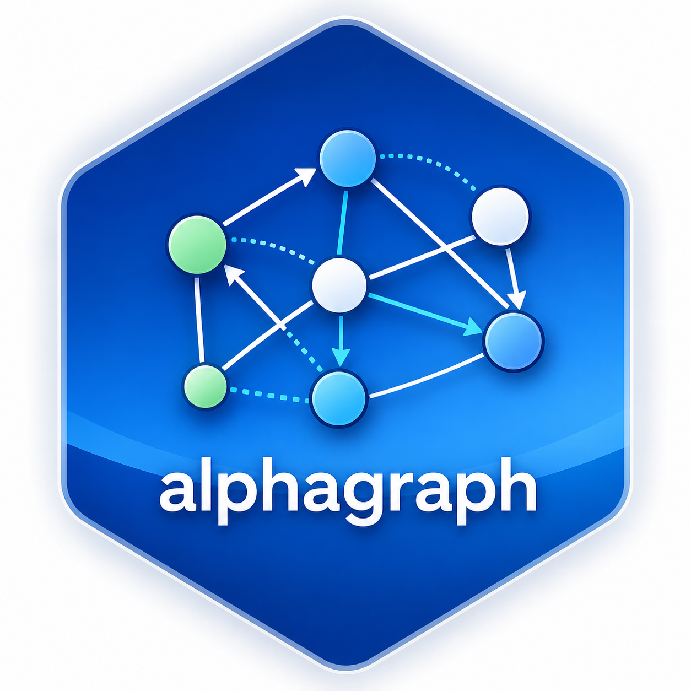

# alphagraph 

**A modern Shiny GUI for graphical multiple comparison procedures**

`alphagraph` is a Shiny-based graphical user interface for designing, visualizing, and analyzing **graphical multiple comparison procedures (gMCPs)** as implemented in the R package [`graphicalMCP`](https://cran.r-project.org/package=graphicalMCP).

The project aims to provide a modern, interactive, and maintainable alternative to the Java-based GUI of the [`gMCP`](https://cran.r-project.org/package=gMCP) package while remaining fully compatible with R-based workflows and future extensions such as **group sequential designs (GSDs)**.

---

## Motivation

Graphical multiple comparison procedures are widely used in confirmatory clinical trials to control the **familywise error rate (FWER)** while allowing flexible allocation and reallocation of significance levels across multiple hypotheses.

The existing `gMCP` package provides a powerful GUI, but its Java-based architecture presents challenges in modern environments:

* Requires a Java installation
* Difficult to deploy in web-based environments
* Harder to maintain and extend
* Less suitable for integration into modern R and Shiny workflows

At the same time, the [`graphicalMCP`](https://cran.r-project.org/package=graphicalMCP) package provides a modern and extensible implementation of graphical testing procedures. `alphagraph` complements this package with an interactive web-based user interface.

---

## Key Features

### Interactive Graph Editor

* Create and edit hypotheses (nodes)
* Create and modify transition relationships (edges)
* Drag-and-drop node positioning
* Grid-based layouts
* Interactive node and edge properties
* Zooming and panning
* Validation of graph consistency

### Graphical MCP Workflows

* Visualization of graphical testing procedures
* Inspection and editing of transition matrices
* Weight allocation and alpha flow visualization
* Integration with `graphicalMCP`

### Modern Architecture

* No Java dependency
* Based on Shiny and JavaScript
* Designed for long-term maintainability
* Modular architecture supporting future extensions

---

## Technology Stack

### R Packages

* `shiny`
* `bs4Dash`
* `visNetwork`
* `igraph`
* `graphicalMCP`

### Why visNetwork?

Several technologies were evaluated, including:

* `igraph`
* `ggplot2`
* `networkD3`
* `cytoscape.js`
* `visNetwork`

After a structured evaluation, `visNetwork` was selected as the preferred graph visualization layer because it provides:

* Excellent Shiny integration
* Bidirectional interaction
* Runtime graph updates
* Interactive graph editing
* Good performance for typical graphical MCP use cases

The underlying graphical testing procedures are represented and analyzed using `graphicalMCP` and `igraph`, while `visNetwork` provides the interactive user interface.

---

## Proof of Concept

A Proof-of-Concept (PoC) application was developed to evaluate the technical feasibility of implementing a Shiny-based graphical MCP editor.

The PoC demonstrated that:

* The look and feel of the original `gMCP` GUI can be closely approximated.
* Interactive graph editing is feasible using modern web technologies.
* User requirements identified from the existing `gMCP` GUI can be implemented without relying on Java.

The PoC focuses on validating technical concepts and user experience and does not yet implement the complete functionality planned for the final application.

---

## Relationship to graphicalMCP

`alphagraph` is intended to serve as a graphical front-end for `graphicalMCP`.

The long-term architecture separates responsibilities:

| Component                                     | Responsibility                                                  |
| --------------------------------------------- | --------------------------------------------------------------- |
| `graphicalMCP`                                | Statistical methods, graph representation, validation, analysis |
| `alphagraph`                                  | Interactive graph editing and visualization                     |
| Future export package (e.g. `alphagraphTikZ`) | Publication-ready TikZ/LaTeX export                             |

This separation allows statistical functionality to remain available in pure R workflows while providing a modern graphical user interface for interactive use.

---

## Future Directions

Planned future developments include:

* Support for group sequential designs
* Advanced graph editing features
* Interactive analysis workflows
* Report generation
* TikZ/LaTeX export
* Integration into RPACT Cloud

---

## Regenerating package documentation

From the repository root, run `roxygen2::roxygenize()` (validated with
roxygen2 8.1.1). `NAMESPACE` is generated from the Roxygen declarations in `R/`;
its historical export pattern is declared in `R/alphagraph-package.R`.
Maintain imports and exports in those declarations rather than editing
`NAMESPACE` directly.

The R6 class, converter, and number-format help pages are also generated from
their R sources. Some other help pages remain hand-maintained; check the
generated-file header before editing an Rd file.

---

## Status

⚠️ **Early development**

`alphagraph` is currently under active development. APIs, functionality, and user interfaces may change substantially before the first public release.

---

## License

alphagraph is open-source software licensed under the
GNU Affero General Public License version 3 ([AGPL-3.0](https://cran.r-project.org/web/licenses/AGPL-3)).

The AGPL license permits use, modification, and distribution of
alphagraph, including commercial use, subject to the terms and
conditions of the AGPL.

RPACT GmbH also offers commercial licenses for organizations that
wish to integrate alphagraph into proprietary software or services
without being subject to the requirements of the AGPL.

For commercial licensing inquiries, please [contact RPACT](https://www.rpact.com/contact/).

---

## Acknowledgements

The development of `alphagraph` is inspired by the graphical testing framework developed by Frank Bretz and colleagues and the existing `gMCP` and `graphicalMCP` packages.

Special thanks to the [`graphicalMCP`](https://cran.r-project.org/package=graphicalMCP) development team for ongoing discussions and collaboration.

